  

## `$ whoami`

Computer Engineer from Portugal, with an MSc in Cybersecurity and Digital Forensics from the University of Leiria and Oeste.

I work across offense, defence and the infrastructure underneath both: malware analysis and detection engineering, mobile and disk forensics, penetration testing, SIEM, and the networks and virtualisation platforms these run on.

## `$ cat stack.txt`

<table>
  <tr>
    <td><b>Security</b></td>
    <td>
      
      
      
      
      
      
      
      
    </td>
  </tr>
  <tr>
    <td><b>Languages</b></td>
    <td>
      
      
      
      
      
      
      
      
    </td>
  </tr>
  <tr>
    <td><b>Frameworks</b></td>
    <td>
      
      
      
      
      
    </td>
  </tr>
  <tr>
    <td><b>Infrastructure</b></td>
    <td>
      
      
      
      
      
      
      
    </td>
  </tr>
  <tr>
    <td><b>Networking</b></td>
    <td>
      
      
      
      
      
      
    </td>
  </tr>
</table>

## `$ gh stats`

  
  

 

  Stats refresh daily via <a href=".github/workflows/profile-assets.yml">GitHub Actions</a>.
   
  

